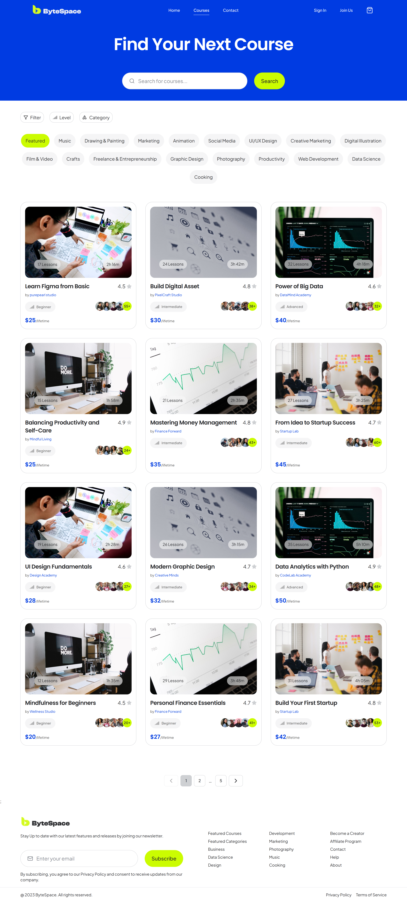
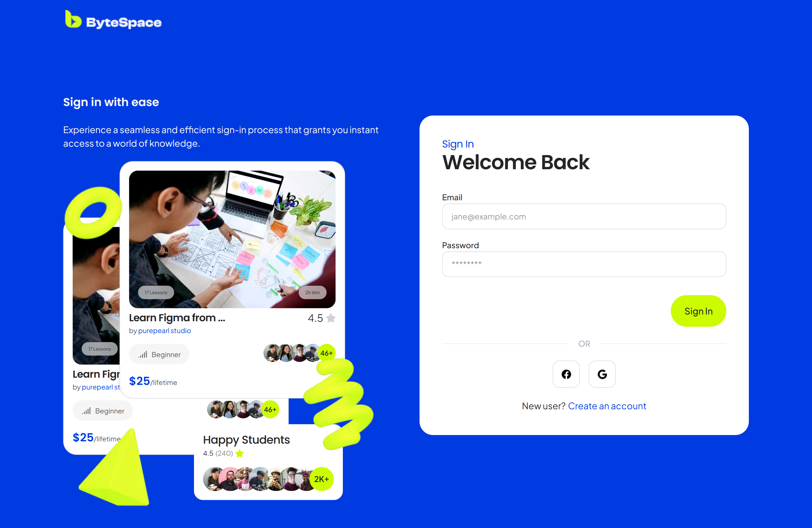
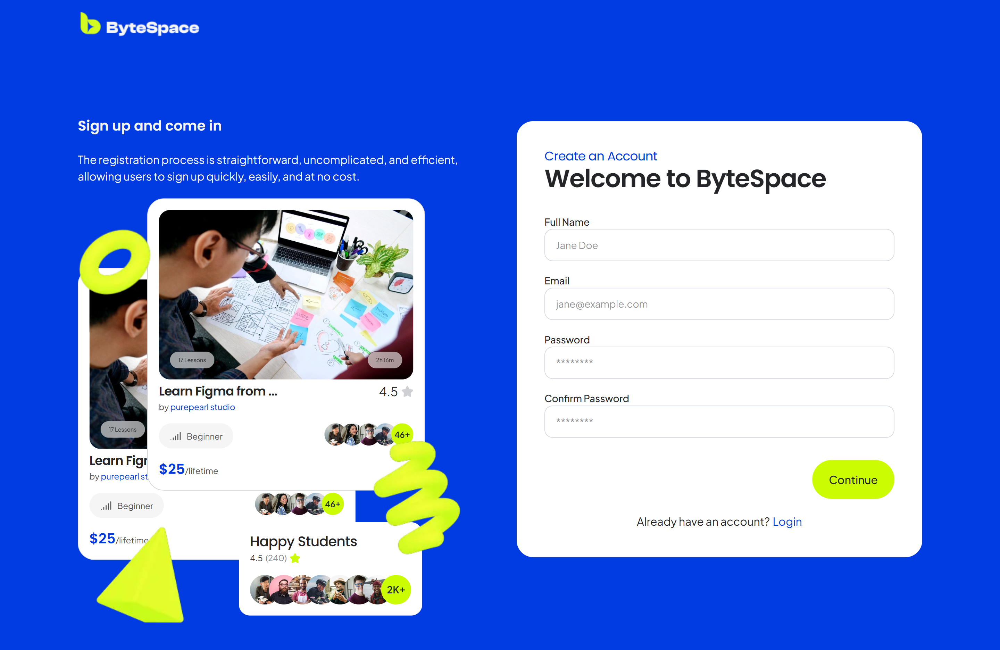

# ByteSpace — Online Learning Platform

A responsive, modern learning platform frontend built with React and TypeScript. Originally developed as a frontend evaluation assessment, ByteSpace has continued to evolve through independent improvements focused on accessibility, responsive design, component architecture, and user experience.

**[Live Demo](https://byte-space-web-seven.vercel.app/) · [GitHub Repository](https://github.com/MahmudaJahan99/Byte-Space)**

## Overview

ByteSpace is a frontend web application designed around an online learning experience. It features a landing page, course discovery interface, category-based course filtering, pagination, testimonials, and dedicated login and signup pages.

What began as an evaluation task became an opportunity to refine the implementation beyond the initial requirements. The project reflects an iterative development approach, with an emphasis on reusable components, maintainable code, accessibility, responsive layouts, and performance.

## Screenshots

### Homepage

The ByteSpace landing page, designed to introduce the platform and showcase its learning experience.

### Course Discovery

The course discovery interface, featuring course listings and filtering controls.

### Authentication Interfaces

The login and signup pages, built with reusable form components and a consistent visual design. These are frontend interfaces and do not currently implement backend authentication.

| Login                                                 | Sign Up                                                 |
| ----------------------------------------------------- | ------------------------------------------------------- |
|  |  |

## Key Features

- **Responsive Design:** Layouts and navigation designed to adapt to different screen sizes.
- **Course Discovery:** Browse courses through dedicated course listings and category-based navigation.
- **Course Filtering:** Explore course options using category selections and filter controls.
- **Search and Pagination:** Custom hooks support course search and paginated content.
- **Authentication Interfaces:** Dedicated login and signup pages with reusable form components.
- **Reusable UI Components:** Shared buttons, inputs, cards, navigation elements, and pagination components.
- **Accessible Interactions:** Accessibility-focused improvements to navigation, forms, and interface elements.
- **Performance Optimization:** Lazy loading and other frontend refinements to improve the browsing experience.
- **Animated UI Elements:** Motion-based interactions and decorative elements that enhance the visual experience.
- **Structured Layouts:** Shared layout components and consistent navigation across relevant pages.

## Technology Stack

| Technology     | Purpose                                         |
| -------------- | ----------------------------------------------- |
| React 19       | Component-based UI development                  |
| TypeScript     | Type safety and maintainable application code   |
| Vite           | Development server and production build tooling |
| Tailwind CSS 4 | Utility-first styling                           |
| React Router 7 | Client-side routing and page navigation         |
| Motion         | UI animations and transitions                   |
| Lucide React   | Interface icons                                 |
| CSS Modules    | Component-scoped styling                        |
| ESLint         | Code quality and linting                        |

## Application Structure

The project follows a modular, component-oriented structure that separates pages, reusable UI, feature-specific components, data, and shared hooks.

### Architectural Highlights

- **Feature-based organization:** Related components are grouped by their responsibility and interface section.
- **Reusable UI layer:** Shared components help maintain consistency and reduce duplication.
- **Custom hooks:** Search, pagination, and scroll-related logic are separated from presentation components.
- **Centralized data modules:** Course information, categories, filter options, and navigation links are maintained separately from UI rendering.
- **Scoped styling:** CSS Modules are used where component-specific styling is appropriate, alongside Tailwind CSS utilities.
- **Shared layout:** A common layout provides a consistent structure for relevant pages.

## Lighthouse Performance

The project has been evaluated using Google Lighthouse to assess performance, accessibility, best practices, and SEO.

### Lighthouse Scores

| Category       |   Score |
| -------------- | ------: |
| Performance    |  89/100 |
| Accessibility  |  92/100 |
| Best Practices | 100/100 |
| SEO            |  92/100 |

### Core Performance Metrics

| Metric                         | Result |
| ------------------------------ | -----: |
| First Contentful Paint (FCP)   |  0.8 s |
| Largest Contentful Paint (LCP) |  1.4 s |
| Total Blocking Time (TBT)      |  10 ms |
| Cumulative Layout Shift (CLS)  |  0.004 |
| Speed Index                    |  2.9 s |

These results provide a baseline for evaluating the application's rendering speed, responsiveness, visual stability, and accessibility. Lighthouse scores can vary depending on the testing environment, device emulation, and network conditions.

## Author

**Mahmuda Jahan**

Frontend Developer | React & TypeScript

- [GitHub](https://github.com/MahmudaJahan99)
- [Live Project](https://byte-space-web-seven.vercel.app/)

---

_Built as a frontend evaluation assessment and continued as an independent project to explore better frontend engineering practices, accessibility, performance, and maintainable UI architecture._
